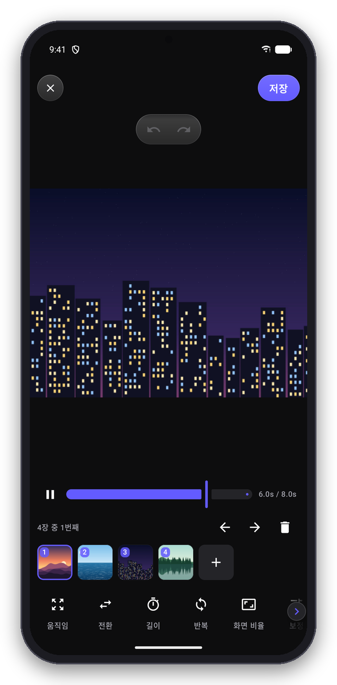
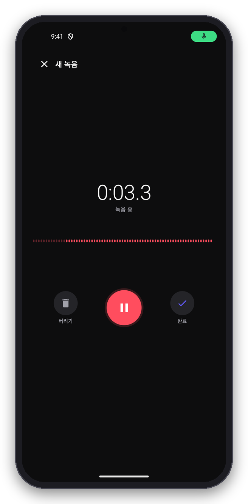
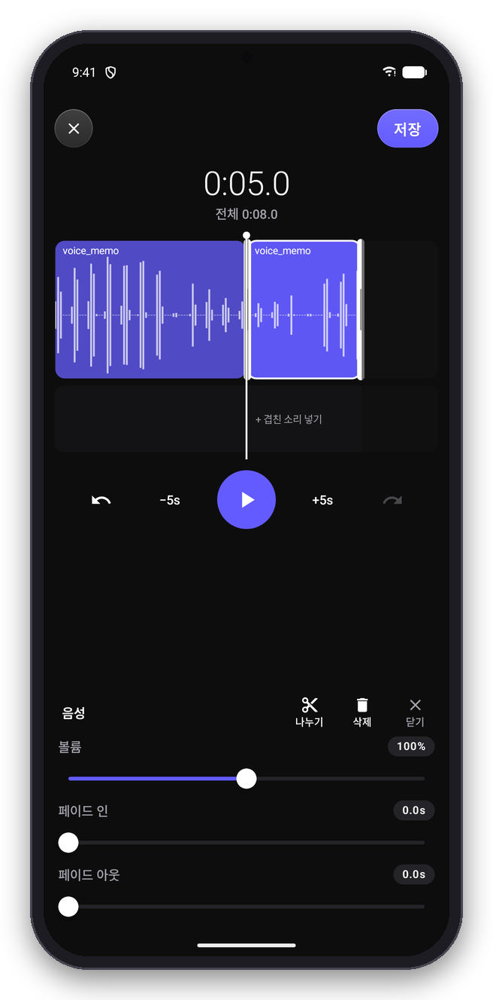
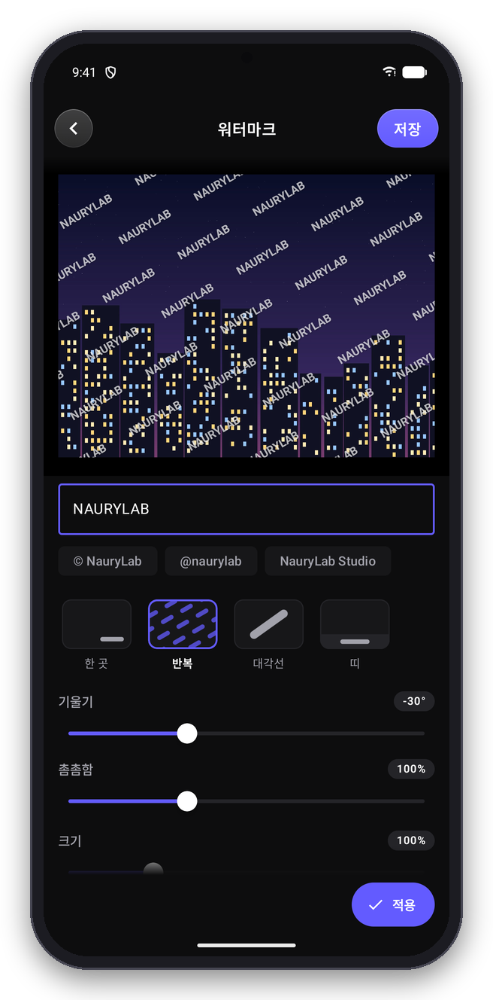
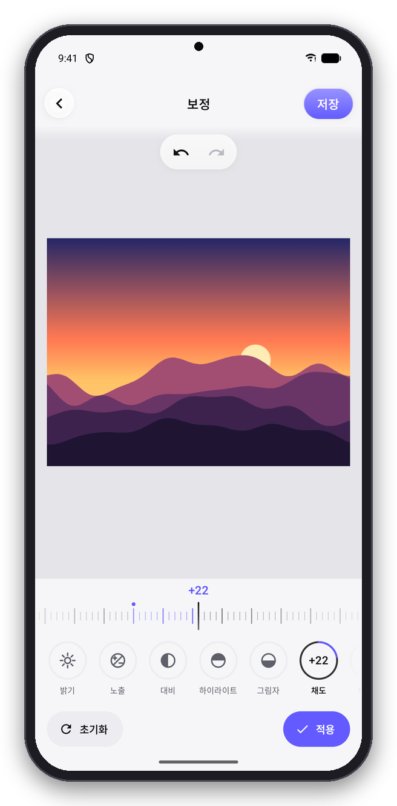
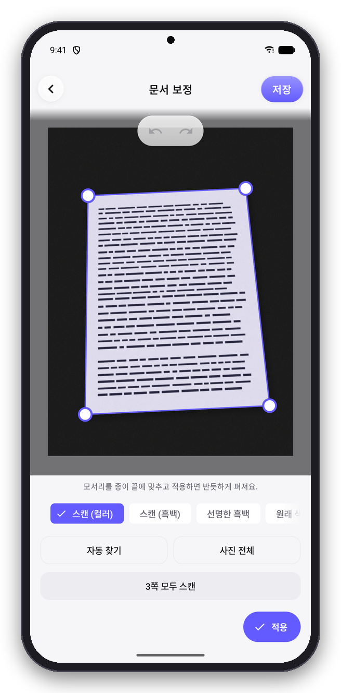
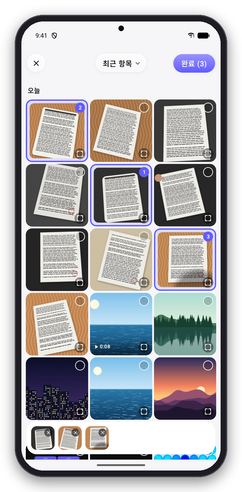
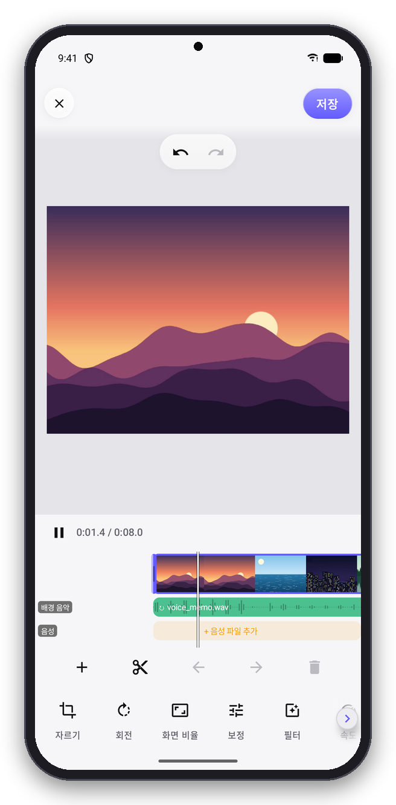
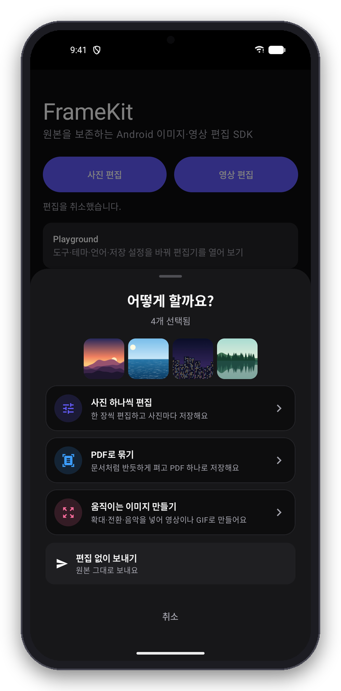

<p align="center">
  <picture>
    <source media="(prefers-color-scheme: dark)" srcset="docs/images/logo-dark.png">
    
  </picture>
</p>

<p align="center">
  <a href="https://central.sonatype.com/artifact/com.naurylab/framekit"></a>
  
  <a href="LICENSE"></a>
</p>

**FrameKit**은 Android 앱에 사진·영상·음성 편집 기능을 더하는 SDK입니다.
갤러리에서 고르기부터 자르기·필터·텍스트, 클립 편집, 녹음, 문서 스캔과 PDF 만들기까지 완성된 화면을 앱에 그대로 붙여 쓸 수 있고, 사용자가 마치면 결과 파일을 받아 바로 활용할 수 있습니다. 원본 파일은 변경되지 않습니다.


## 기능

- **사진**: 자르기·회전, 보정·필터, 텍스트·스티커·그리기, 모자이크, 배경 제거, 여러 장 편집
- **문서 스캔·PDF**: 카메라로 문서 테두리를 실시간으로 찾아 자동 촬영, 원근 보정, 컬러·흑백 스캔, 여러 쪽 한 번에 스캔, 글자 검색이 되는 PDF
- **영상**: 여러 클립 이어 붙이기·자르기, 보정·필터·속도, 배경 음악·음성, 텍스트·스티커, MP4 저장
- **움직이는 이미지**: 사진으로 슬라이드쇼 만들기, GIF·WebP 편집, MP4·GIF·WebP 저장
- **음성**: 녹음(탭·누르고 말하기), 소리 파일 편집, M4A 저장
- **워터마크**: 사진·영상에 문구 워터마크(반복·대각선·띠 패턴, 수정 잠금)
- **갤러리**: 앨범·날짜별 보기, 고른 순서 표시, 크게 보기(확대·축소), 개수·크기·길이 제한. 권한이 없으면 시스템 사진 선택기로 대신
- **그 밖에**: 촬영 후 바로 편집, 화면 없이 코드로 처리(headless), 앱 전용 필터·스티커·폰트, 다크·라이트 테마와 브랜드 색상, 13개 언어, 폴드·태블릿 화면

## 화면

편집 화면은 다크·라이트 테마를 모두 지원합니다(`EditorUiConfig(themeMode = …)`).

### 다크 모드

<table>
  <tr>
    <td align="center" width="25%"><br><b>사진 편집</b><br>보정·필터·텍스트</td>
    <td align="center" width="25%"><br><b>문서 스캔</b><br>원근 보정·여러 쪽 스캔</td>
    <td align="center" width="25%"><br><b>갤러리</b><br>앨범·순서·크게 보기</td>
    <td align="center" width="25%"><br><b>영상 편집</b><br>클립·음악·음성 줄</td>
  </tr>
  <tr>
    <td align="center"><br><b>움직이는 이미지</b><br>사진으로 슬라이드쇼</td>
    <td align="center"><br><b>녹음</b><br>탭·누르고 말하기</td>
    <td align="center"><br><b>음성 편집</b><br>파형·나누기·끼워 넣기</td>
    <td align="center"><br><b>워터마크</b><br>한 곳·반복·대각선·띠</td>
  </tr>
</table>

### 라이트 모드

<table>
  <tr>
    <td align="center" width="25%"><br><b>사진 편집</b><br>보정·필터·텍스트</td>
    <td align="center" width="25%"><br><b>문서 스캔</b><br>원근 보정·여러 쪽 스캔</td>
    <td align="center" width="25%"><br><b>갤러리</b><br>앨범·순서·크게 보기</td>
    <td align="center" width="25%"><br><b>영상 편집</b><br>클립·음악·음성 줄</td>
  </tr>
  <tr>
    <td align="center"><br><b>움직이는 이미지</b><br>사진으로 슬라이드쇼</td>
    <td align="center"><br><b>녹음</b><br>탭·누르고 말하기</td>
    <td align="center"><br><b>음성 편집</b><br>파형·나누기·끼워 넣기</td>
    <td align="center"><br><b>워터마크</b><br>한 곳·반복·대각선·띠</td>
  </tr>
</table>

## 설치

```kotlin
// settings.gradle.kts
dependencyResolutionManagement {
    repositories {
        google()
        mavenCentral()
    }
}

// app/build.gradle.kts
dependencies {
    implementation("com.naurylab:framekit:1.0.0-alpha05")
}
```

필요한 편집기만 쓰려면 해당 모듈만 추가하면 됩니다.

| 모듈 | 내용 |
| --- | --- |
| `framekit` | 전체 편집기와 통합 진입점(`FrameKitContract`) |
| `framekit-ui-image` | 사진 편집기(`ImageEditorContract`) |
| `framekit-ui-video` | 영상 편집기(`VideoEditorContract`) |
| `framekit-ui-motion` | 움직이는 이미지 편집기(`MotionEditorContract`) |
| `framekit-ui-audio` | 음성 편집기(`AudioEditorContract`) |
| `framekit-picker` | 앱 안 사진·영상 갤러리(`MediaPickerContract`) |
| `framekit-scanner` | 카메라 문서 스캐너(`DocumentScanContract`) |
| `framekit-segmentation` | (선택) 배경 제거 |
| `framekit-ocr` | (선택) PDF 글자 검색 |

- minSdk 26, Kotlin 2.2 이상이 필요합니다. 앱이 Compose를 쓰지 않아도 사용할 수 있습니다.
- R8/ProGuard 규칙을 따로 추가할 필요가 없습니다.

## 사용법

### 편집기 열기

```kotlin
class MainActivity : ComponentActivity() {

    private val editor = registerForActivityResult(FrameKitContract()) { result ->
        when (result) {
            is FrameKitResult.Success -> show(result.output.uri, result.output.mediaType)
            FrameKitResult.Cancelled -> Unit
            is FrameKitResult.Failure -> showError(result.error.code)
        }
    }

    fun edit() {
        // 사용자가 고른 파일에 맞는 편집기가 열린다.
        editor.launch(FrameKitRequest(EditorInput.Pick(MediaKind.ANY)))
    }
}
```

Compose에서는 `rememberLauncherForActivityResult(FrameKitContract())`를 사용합니다. 여러 장을 각각 저장한 경우처럼 결과가 여러 개이면 `result.outputs`로 모두 받을 수 있습니다.

### 입력 지정

```kotlin
EditorInput.UriSource(uri)                              // 파일 하나
EditorInput.Multiple(uris.map(EditorInput::UriSource))  // 파일 여러 개
EditorInput.Pick(MediaKind.IMAGE, maxItems = 10)        // 갤러리에서 사진 최대 10장 선택
EditorInput.Pick(MediaKind.AUDIO, maxItems = 5)         // 오디오 파일 최대 5개 선택
EditorInput.Capture(MediaKind.IMAGE)                    // 촬영 후 편집 (VIDEO는 녹화 후 편집)
EditorInput.Capture(MediaKind.AUDIO)                    // 녹음 후 편집
```

파일 종류(사진·영상·움직이는 GIF·오디오)에 따라 알맞은 편집기가 자동으로 열립니다.

### 작업 선택 화면

편집기를 바로 여는 대신, 선택한 파일을 보여 주고 **편집 / PDF로 묶기 / 움직이는 이미지 만들기 / 편집 없이 보내기** 중 원하는 작업을 고르게 할 수 있습니다.

<p align="center"></p>

```kotlin
editor.launch(FrameKitRequest(EditorInput.Multiple(uris.map(EditorInput::UriSource)), chooser = EditorChooser.ASK))
```

'편집 없이 보내기'를 고르면 원본 파일이 그대로 `Success`로 전달되며, 이때 `isOriginal`은 `true`입니다.

### 자주 쓰는 설정

```kotlin
// 도구 제한, 저장 형식, 영상 길이, 테마
FrameKitRequest(
    EditorInput.UriSource(uri),
    image = ImageEditorConfig(enabledTools = setOf(ImageTool.CROP, ImageTool.ROTATE)),
    imageExport = ImageExportConfig(format = ImageFormat.PNG, maxWidth = 2048),
    video = VideoEditorConfig(maxTimelineDurationUs = 15_000_000),
    ui = EditorUiConfig(themeMode = ThemeMode.LIGHT, primaryArgb = 0xFF1E6BFF.toInt()),
)

// 누르고 말하기로 녹음한 뒤 편집 없이 바로 받기
FrameKitRequest(
    EditorInput.Capture(MediaKind.AUDIO),
    audio = AudioEditorConfig(recordMode = RecordMode.HOLD, editAfterRecording = false),
)

// 워터마크: 앱에서 정한 문구를 사용자가 바꿀 수 없도록 고정
val watermark = WatermarkConfig(text = "© MyShop", pattern = WatermarkPattern.TILE, applyOnOpen = true, locked = true)
FrameKitRequest(EditorInput.Pick(MediaKind.ANY), image = ImageEditorConfig(watermark = watermark), video = VideoEditorConfig(watermark = watermark))
```

움직이는 이미지 편집기는 `MotionEditorContract`로 엽니다.

```kotlin
val motion = registerForActivityResult(MotionEditorContract()) { result -> /* ... */ }
motion.launch(MotionEditorRequest(EditorInput.Pick(MediaKind.IMAGE, maxItems = 20)))
```

### 문서를 스캔해 PDF로

```kotlin
val pdf = ImageExportConfig(format = ImageFormat.PDF, pdf = PdfOptions(pageSize = PdfPageSize.A4))

// 카메라로 스캔: 문서 테두리를 실시간으로 찾아 자동으로 찍고, 여러 쪽을 펴서 PDF 편집기로 넘긴다.
editor.launch(FrameKitRequest(EditorInput.Capture(MediaKind.IMAGE), imageExport = pdf))

// 이미 찍어 둔 사진으로
editor.launch(FrameKitRequest(EditorInput.Pick(MediaKind.IMAGE, maxItems = 20), imageExport = pdf))
```

카메라로 스캔할 때는 문서 테두리가 화면에 표시되고, 잠시 흔들리지 않으면 자동으로 찍힙니다(수동 촬영도 됩니다). 찍은 쪽은 반듯하게 펴서 PDF 편집기로 넘어갑니다. 스캐너만 따로 쓰려면 `DocumentScanContract`를 씁니다.

PDF로 저장할 때는 편집기 도구 맨 앞에 **문서 보정**이 나옵니다. 문서 테두리를 자동으로 찾아 반듯하게 펴고, 컬러·흑백 스캔을 고를 수 있으며, **모든 쪽 스캔**으로 여러 쪽을 한 번에 처리합니다. 테두리를 찾지 못한 쪽은 모서리를 직접 맞추면 됩니다. `framekit-ocr`을 추가하면 PDF에서 글자 검색·복사가 됩니다.

### 화면 없이 처리

편집 화면을 띄우지 않고 코드만으로 같은 편집을 적용해 저장할 수 있습니다.

```kotlin
ImageProcessor(context).use { processor ->
    val source = processor.open(EditorInput.UriSource(uri))
    val project = processor.newProject(source).copy(filter = FilterSelection("bright", 1.0))
    val result = processor.startExport(project, source, ImageExportConfig(), scope = lifecycleScope).awaitResult()
}
```

영상은 `VideoProcessor`를 같은 방식으로 사용합니다.

### 앱 전용 필터·스티커·폰트 추가

```kotlin
FrameKitRequest(
    EditorInput.Pick(MediaKind.ANY),
    catalog = EditorCatalog(
        filters = listOf(CustomFilter("brand-warm", "Warm", temperature = 0.4)),
        stickers = listOf(CustomSticker("logo", "Logo", CatalogFile.Asset("stickers/logo.png"))),
        fonts = listOf(CustomFont("brand", "Brand", CatalogFile.Asset("fonts/brand.ttf"))),
    ),
)
```

### 앱 안 갤러리로 고르기

```kotlin
val picker = registerForActivityResult(MediaPickerContract()) { result ->
    if (result is MediaPickerResult.Picked) result.items.forEach { show(it.uri) } // 고른 순서
}
picker.launch(MediaPickerRequest(MediaKind.ANY, maxItems = 10, maxFileSizeBytes = 50L * 1024 * 1024, maxVideoDurationMs = 60_000))
```

호스트가 사진 읽기 권한(`READ_MEDIA_IMAGES`·`READ_MEDIA_VIDEO`)을 선언한 경우에만 앱 안 갤러리가 열리고, 아니면 시스템 사진 선택기가 열립니다. 편집기가 원본을 고를 때도 같은 화면을 씁니다. 자세한 내용은 [연동 가이드](docs/integration.md#앱-안-갤러리-사진영상-고르기)를 보세요.

### 결과 파일

- 결과 파일은 앱 내부 저장소에 저장되고 `content://` Uri로 전달됩니다. 파일 관리는 앱이 맡으며, 더 이상 필요 없으면 `FrameKitOutputs.deleteOutput(context, uri)`로 삭제하세요.
- 다른 앱과 공유할 때는 Intent에 `FLAG_GRANT_READ_URI_PERMISSION`을 추가하세요.

## 주의사항

- 기본 모듈은 권한을 추가하지 않습니다. 원본 파일을 읽을 권한은 앱에서 확보해야 합니다.
- 앱 안 갤러리에 쓰는 `READ_MEDIA_IMAGES`·`READ_MEDIA_VIDEO`는 Google Play 정책상 사진·영상 전체 접근이 핵심 기능인 앱만 선언할 수 있습니다. 해당하지 않으면 선언하지 마세요(시스템 사진 선택기로 동작).
- 녹음 기능을 쓰려면 앱 manifest에 `RECORD_AUDIO`를 선언하세요. 선언하지 않으면 녹음 버튼이 표시되지 않습니다.
- 앱이 `CAMERA`를 선언한 경우, 촬영할 때 SDK가 권한을 요청합니다. 카메라 문서 스캐너(실시간 테두리 인식)는 `CAMERA`를 선언했을 때만 쓰며, 아니면 기기 카메라 앱으로 한 장을 찍어 펴 줍니다.
- 배경 제거·글자 검색 모듈은 Google Play 서비스(ML Kit)가 필요하며 `INTERNET` 권한이 추가됩니다. 처음 사용할 때 모델을 내려받을 수 있습니다.
- 사진과 영상을 함께 섞어 편집할 수는 없습니다.
- 결과는 앱 내부 저장소에만 저장됩니다. 갤러리에 저장하려면 앱에서 직접 처리하세요.
- 저장할 때 위치 정보 같은 민감한 메타데이터는 기본으로 제거됩니다.
- 편집 중 앱이 종료되어도 적용한 편집 내용은 복원되지만, 실행 취소 기록은 복원되지 않습니다.
- `localeTag`로 언어를 고정한 상태에서 App Bundle 언어 분할을 사용하면 일부 문구가 누락될 수 있습니다.

## 문서

- [연동 가이드](docs/integration.md): 편집기별 사용 예시, 결과·오류 처리, 움직이는 이미지·음성·워터마크·앱 안 갤러리
- [설정](docs/configuration.md): 전체 옵션의 기본값과 범위
- [화면 없이 처리](docs/headless.md)
- [지원 형식](docs/supported-formats.md)
- [변경 이력](docs/release-notes.md)

`app` 모듈은 모든 기능을 직접 실행해 볼 수 있는 예제 앱입니다.

## License

Apache License 2.0으로 배포됩니다. 자세한 내용은 [LICENSE](LICENSE)를 참고하세요. 일부 아이콘은 [Material Icons](https://github.com/google/material-design-icons)를 사용합니다([NOTICE](NOTICE)).
