<p align="center">
  <picture>
    <source media="(prefers-color-scheme: dark)" srcset="docs/images/logo-dark.png">
    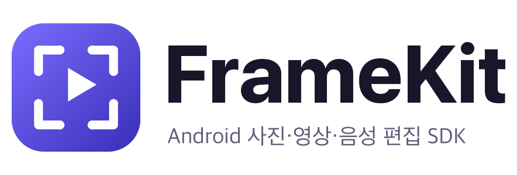
  </picture>
</p>

<p align="center">
  <a href="https://central.sonatype.com/artifact/com.naurylab/framekit"></a>
  
  <a href="LICENSE"></a>
</p>

**FrameKit**은 Android 앱에 사진, 영상, 음성 편집 화면을 붙이는 SDK입니다.
편집기를 열면 사용자가 고르고 고치고 저장하는 화면까지 모두 들어 있고, 앱은 결과 파일만 받으면 됩니다. 원본 파일은 바꾸지 않습니다.

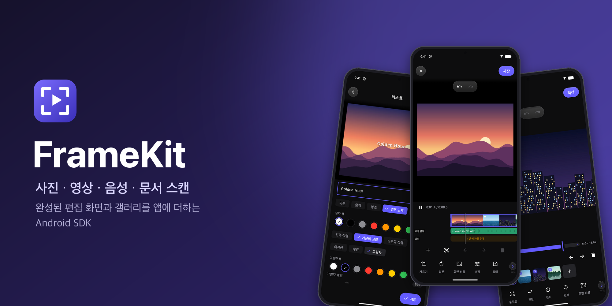

## 기능

- **사진**: 자르기와 회전, 보정과 필터, 텍스트와 스티커, 그리기와 도형, 모자이크, 배경 제거를 여러 장에 한 번에 씁니다.
- **문서 스캔과 PDF**: 카메라가 문서 테두리를 찾아 자동으로 찍고 반듯하게 펴서, 글자 검색이 되는 PDF로 묶습니다.
- **영상**: 여러 클립을 잇고 자르며, 필터와 속도, 배경 음악과 녹음, 텍스트를 넣어 MP4로 저장합니다.
- **움직이는 이미지**: 사진으로 슬라이드쇼를 만들거나 GIF와 WebP를 고쳐 MP4, GIF, WebP로 저장합니다.
- **음성**: 탭하거나 누르고 말해서 녹음하고, 파형을 보며 나누고 끼워 넣어 M4A로 저장합니다.
- **워터마크**: 사진과 영상에 문구를 한 곳, 반복, 대각선, 띠 모양으로 넣고 사용자가 지우지 못하게 잠글 수 있습니다.
- **갤러리**: 앨범과 날짜별로 보고, 고른 순서를 보여 주고, 크게 보며 고릅니다. 권한이 없으면 시스템 사진 선택기를 씁니다.
- **폴드와 태블릿**: 넓은 화면에서는 도구를 옆으로 옮기고, 반쯤 접으면 접힌 선을 따라 화면과 조작부를 나눕니다.
- **꾸미기**: 다크와 라이트 테마, 브랜드 색, 모서리, 글꼴을 앱에 맞추고 13개 언어로 보여 줍니다. 화면은 [Kinetica](https://github.com/Naury74/Kinetica-Kit-SDK) UI 키트로 그립니다.
- **화면 없이 처리**: 편집 화면을 띄우지 않고 코드만으로 같은 편집을 적용해 저장할 수 있습니다.

## 화면

윗줄은 다크 테마, 아랫줄은 라이트 테마입니다.

<table>
  <tr>
    <td align="center" width="25%">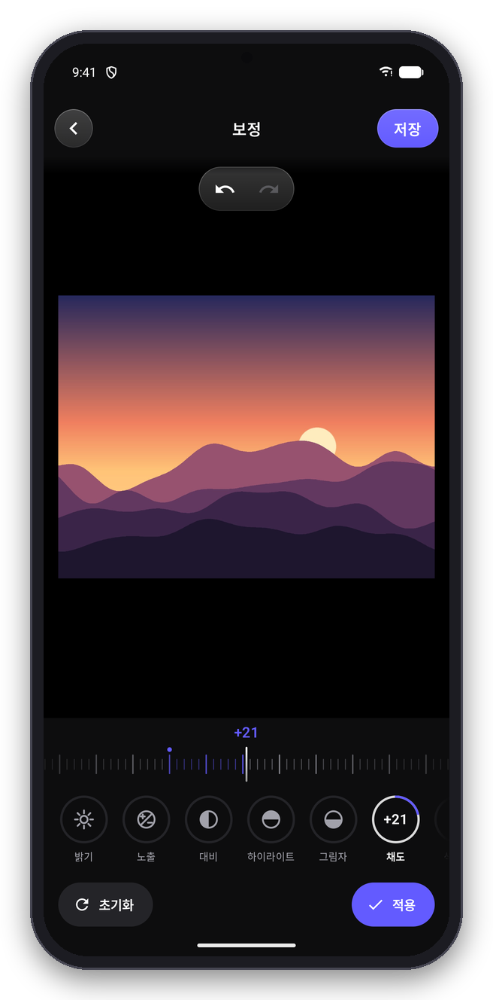<br><b>사진 편집</b></td>
    <td align="center" width="25%">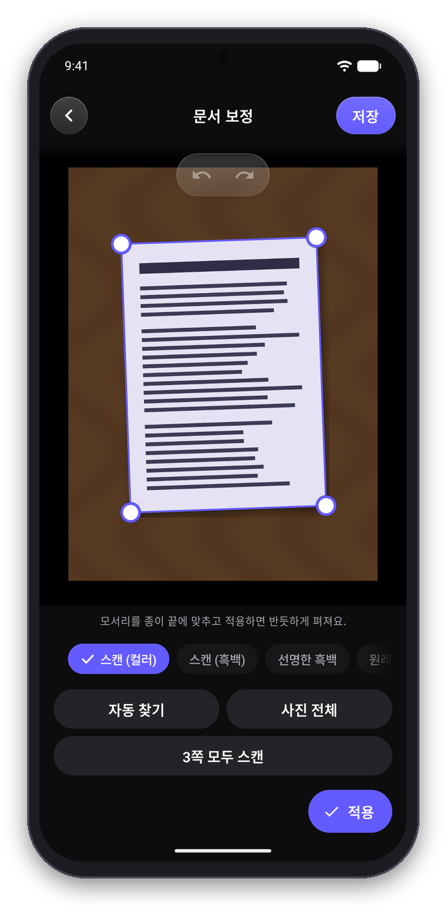<br><b>문서 스캔</b></td>
    <td align="center" width="25%">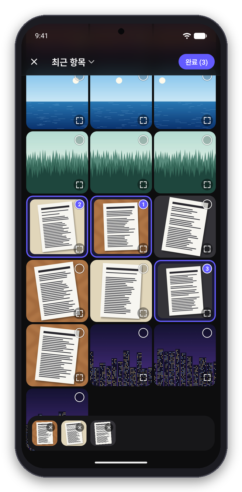<br><b>갤러리</b></td>
    <td align="center" width="25%">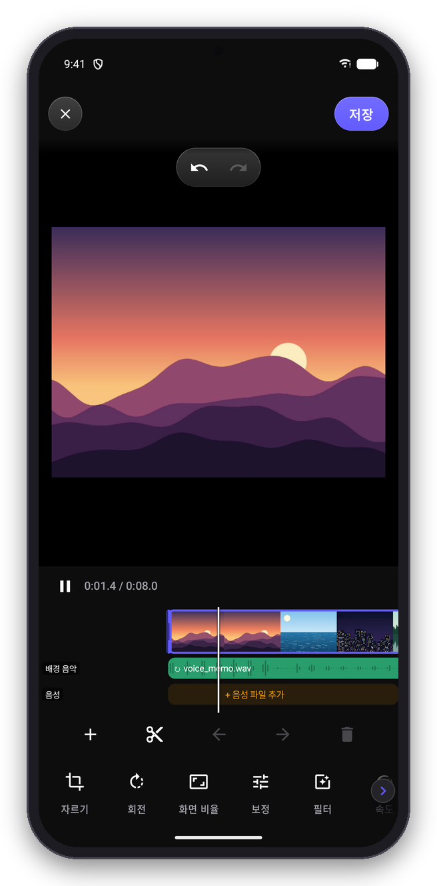<br><b>영상 편집</b></td>
  </tr>
  <tr>
    <td align="center">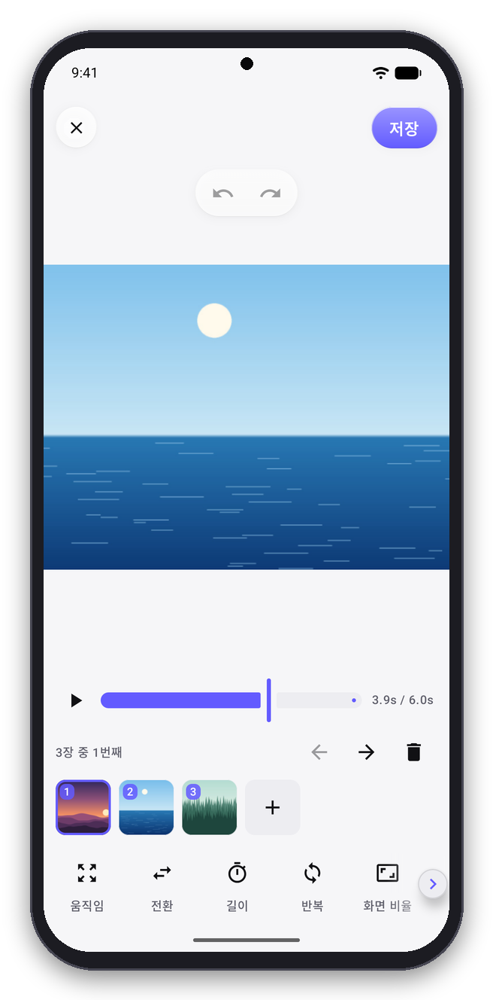<br><b>움직이는 이미지</b></td>
    <td align="center">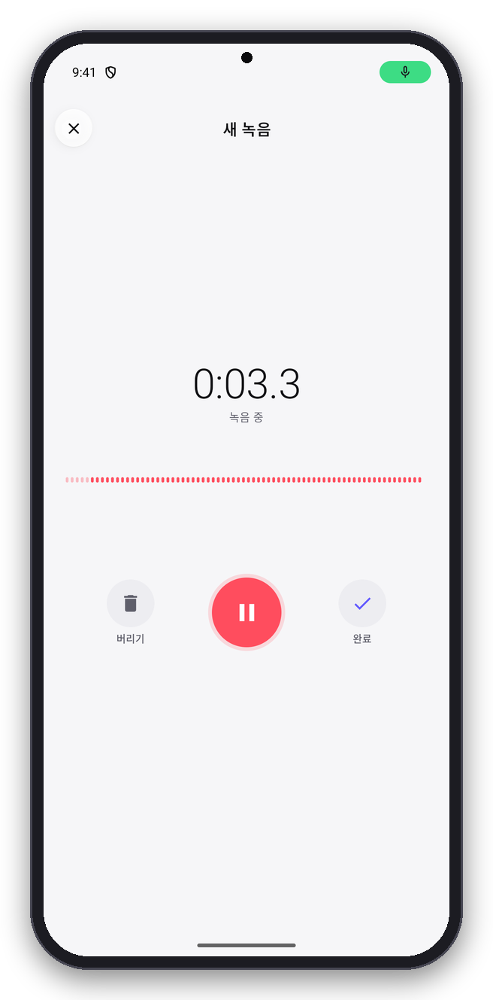<br><b>녹음</b></td>
    <td align="center">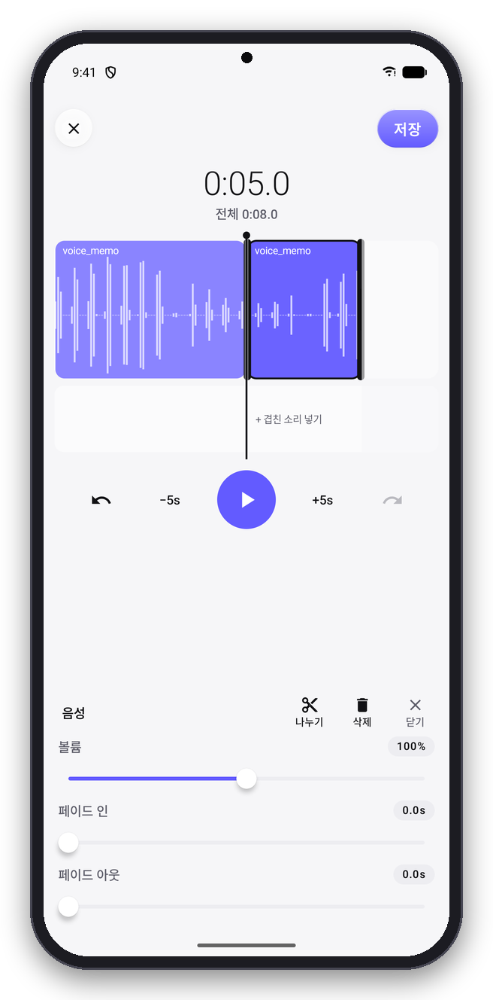<br><b>음성 편집</b></td>
    <td align="center">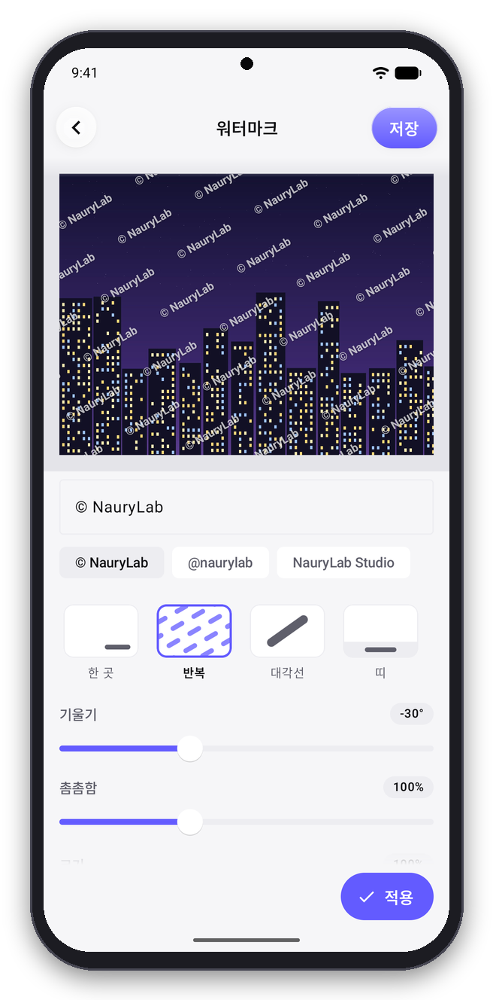<br><b>워터마크</b></td>
  </tr>
</table>

넓은 화면에서는 이렇게 보입니다.

<table>
  <tr>
    <td align="center" width="33%">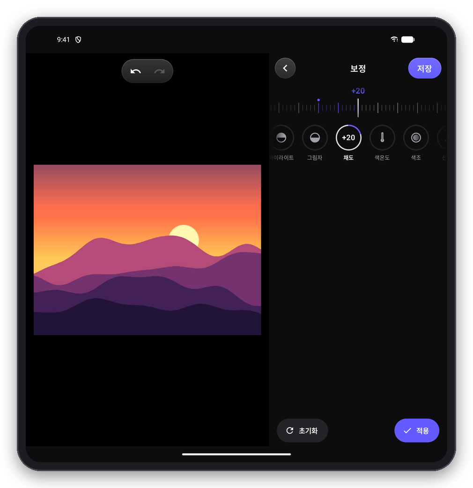<br><b>사진 편집</b><br>도구를 옆 패널에</td>
    <td align="center" width="33%">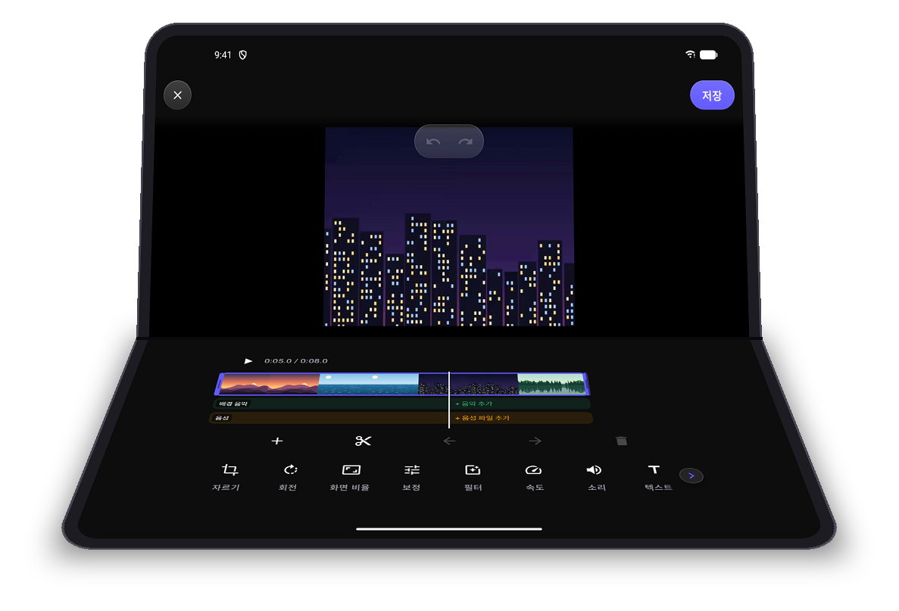<br><b>영상 편집</b><br>반쯤 접으면 위는 영상, 아래는 도구</td>
    <td align="center" width="33%">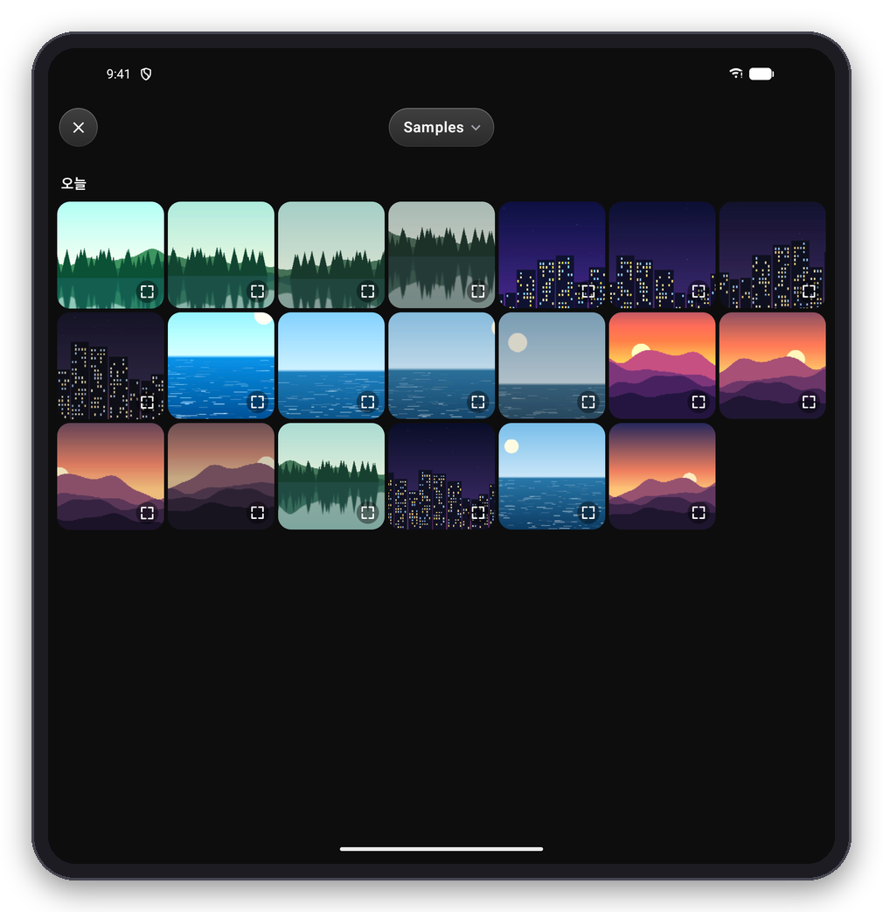<br><b>갤러리</b><br>폭에 맞춰 늘어나는 격자</td>
  </tr>
</table>

## 샘플 앱

[framekit-showcase.apk](https://github.com/Naury74/Naury-Frame-Kit-SDK/releases/latest/download/framekit-showcase.apk)를 받으면 소스 없이 모든 편집기를 써 볼 수 있습니다. 기능별 예제와 설정을 바꿔 가며 편집기를 여는 Playground가 들어 있습니다. Android 8.0 이상에서 설치되고, 처음에는 "출처를 알 수 없는 앱" 설치를 허용해야 합니다.

## 설치

```kotlin
// settings.gradle.kts
dependencyResolutionManagement {
    repositories {
        google()
        mavenCentral()
    }
}

// app/build.gradle.kts
dependencies {
    implementation("com.naurylab:framekit:1.0.0-alpha08")
}
```

필요한 편집기만 쓰려면 그 모듈만 넣습니다.

| 모듈 | 내용 |
| --- | --- |
| `framekit` | 전체 편집기와 통합 진입점 `FrameKitContract` |
| `framekit-ui-image` | 사진 편집기 `ImageEditorContract` |
| `framekit-ui-video` | 영상 편집기 `VideoEditorContract` |
| `framekit-ui-motion` | 움직이는 이미지 편집기 `MotionEditorContract` |
| `framekit-ui-audio` | 음성 편집기 `AudioEditorContract` |
| `framekit-picker` | 앱 안 갤러리 `MediaPickerContract` |
| `framekit-scanner` | 카메라 문서 스캐너 `DocumentScanContract` |
| `framekit-segmentation` | 배경 제거 (선택) |
| `framekit-ocr` | PDF 글자 검색 (선택) |

minSdk 26, Kotlin 2.2 이상이면 됩니다. 앱이 Compose를 쓰지 않아도 되고, R8 규칙을 따로 넣을 필요도 없습니다.

## 사용법

```kotlin
class MainActivity : ComponentActivity() {

    private val editor = registerForActivityResult(FrameKitContract()) { result ->
        when (result) {
            is FrameKitResult.Success -> show(result.output.uri, result.output.mediaType)
            FrameKitResult.Cancelled -> Unit
            is FrameKitResult.Failure -> showError(result.error.code)
        }
    }

    // 사용자가 고른 파일 종류에 맞는 편집기가 열린다.
    fun edit() = editor.launch(FrameKitRequest(EditorInput.Pick(MediaKind.ANY)))
}
```

입력은 이렇게 고릅니다.

```kotlin
EditorInput.UriSource(uri)                              // 파일 하나
EditorInput.Multiple(uris.map(EditorInput::UriSource))  // 파일 여러 개
EditorInput.Pick(MediaKind.IMAGE, maxItems = 10)        // 갤러리에서 사진 최대 10장
EditorInput.Capture(MediaKind.IMAGE)                    // 찍은 뒤 편집. AUDIO면 녹음 뒤 편집
```

도구, 저장 형식, 테마는 요청에 함께 넘깁니다.

```kotlin
FrameKitRequest(
    EditorInput.UriSource(uri),
    image = ImageEditorConfig(enabledTools = setOf(ImageTool.CROP, ImageTool.ROTATE)),
    imageExport = ImageExportConfig(format = ImageFormat.PNG, maxWidth = 2048),
    ui = EditorUiConfig(themeMode = ThemeMode.LIGHT, primaryArgb = 0xFF1E6BFF.toInt()),
)
```

문서를 스캔해 PDF로 받으려면 `imageExport`를 PDF로 두고 카메라로 엽니다.

```kotlin
val pdf = ImageExportConfig(format = ImageFormat.PDF, pdf = PdfOptions(pageSize = PdfPageSize.A4))
editor.launch(FrameKitRequest(EditorInput.Capture(MediaKind.IMAGE), imageExport = pdf))
```

결과 파일은 앱 내부 저장소에 저장되고 `content://` Uri로 옵니다. 다른 앱과 공유할 때는 Intent에 `FLAG_GRANT_READ_URI_PERMISSION`을 붙이고, 필요 없어지면 `FrameKitOutputs.deleteOutput(context, uri)`로 지웁니다.

작업 고르기 화면, 화면 없이 처리, 앱 전용 필터와 스티커, 갤러리와 스캐너 단독 사용은 [연동 가이드](docs/integration.md)에 있습니다.

## 주의사항

- 기본 모듈은 권한을 추가하지 않습니다. 원본을 읽을 권한은 앱이 확보합니다.
- 앱 안 갤러리는 앱이 `READ_MEDIA_IMAGES`, `READ_MEDIA_VIDEO`를 선언했을 때만 열립니다. Google Play 정책상 사진 전체 접근이 핵심 기능인 앱만 선언할 수 있고, 선언하지 않으면 시스템 사진 선택기를 씁니다.
- 녹음은 앱이 `RECORD_AUDIO`를 선언해야 보입니다. 실시간 문서 스캐너는 `CAMERA`를 선언했을 때만 쓰고, 아니면 기기 카메라 앱으로 찍습니다.
- 배경 제거와 글자 검색은 Google Play 서비스가 필요하고 `INTERNET` 권한이 함께 들어옵니다. 처음 쓸 때 모델을 내려받을 수 있습니다.
- 사진과 영상을 섞어 한 번에 편집할 수는 없습니다.
- 결과는 앱 내부 저장소에만 저장합니다. 위치 정보 같은 민감한 메타데이터는 기본으로 지웁니다.
- 편집 중 앱이 종료되면 편집 내용은 복원되지만 실행 취소 기록은 복원되지 않습니다.
- 앱이 kinetica-ui를 직접 쓴다면 1.0.0-alpha05 이상을 쓰세요.

## 문서

- [연동 가이드](docs/integration.md)
- [설정](docs/configuration.md)
- [화면 없이 처리](docs/headless.md)
- [지원 형식](docs/supported-formats.md)
- [변경 이력](docs/release-notes.md)

## License

Apache License 2.0으로 배포합니다. 자세한 내용은 [LICENSE](LICENSE)를 보세요. 일부 아이콘은 [Material Icons](https://github.com/google/material-design-icons)를 씁니다([NOTICE](NOTICE)).
